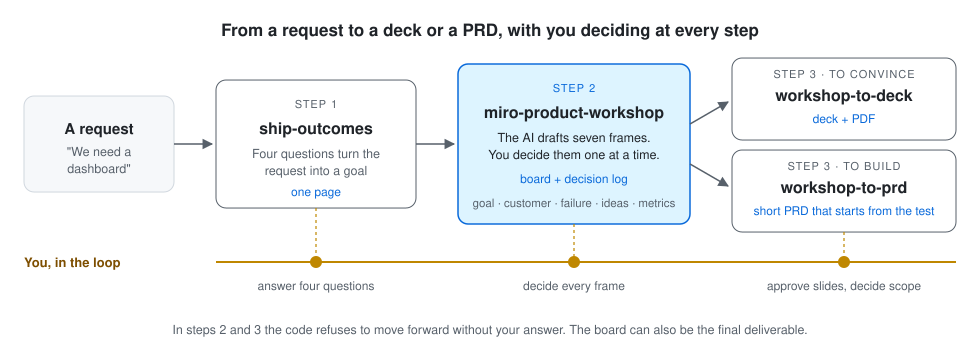
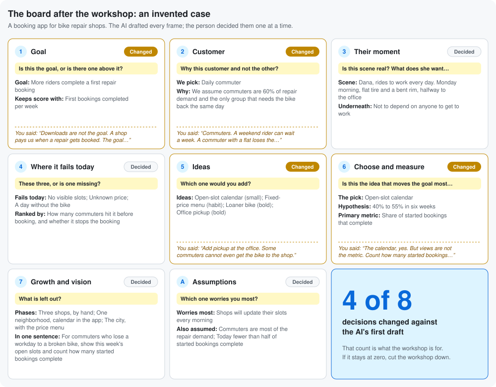
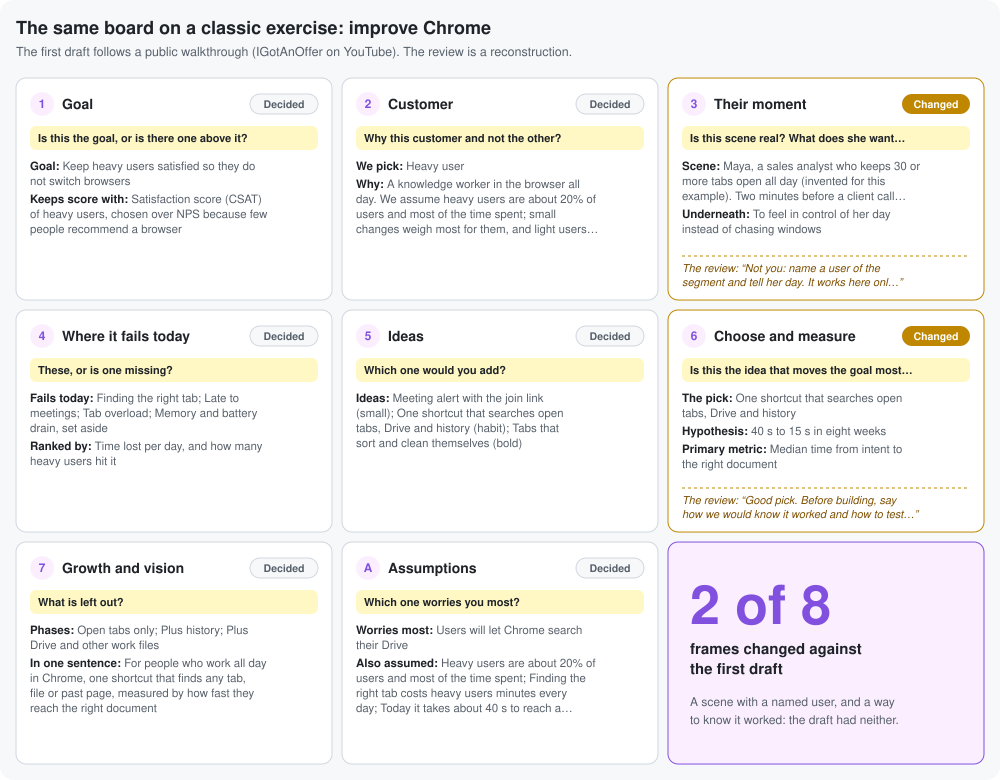

# PM Skills · Human in the loop

**The AI drafts the board. You change its mind, one frame at a time.**

Four Claude skills for the first mile of product management: the stretch between "we need a dashboard" and a deck or a PRD someone will act on. The AI writes the first draft of every step. It cannot move to the next one until you have decided.

## How it flows



## The skills

| You start with | Skill | What you do | You leave with |
|---|---|---|---|
| A request with no clear goal ("we need a dashboard") | [`ship-outcomes`](skills/ship-outcomes/) | Answer four questions, one at a time | One page: the behavior that should change, the assumption that would kill it, the cheapest test and the metrics |
| That page, a brief or an idea of your own | [`product-workshop`](skills/product-workshop/) | Discuss a Miro board frame by frame. Each frame is a question for you | The board, and a log of what the draft said and what you changed |
| A board you have already discussed, and people to convince | [`workshop-to-deck`](skills/workshop-to-deck/) | Approve the slide script, slide by slide, before anything is generated | A deck and its PDF, where every number traces back to the board |
| A board you have already discussed, and something to build | [`workshop-to-prd`](skills/workshop-to-prd/) | Decide the scope of the first version, what is left out and the edge cases | A short PRD that starts from the test, where every requirement answers a failure on the board |

They chain, and each one also works alone. The four answers of `ship-outcomes` pre-fill four frames of the workshop. The board can be the final deliverable, with no deck and no PRD at all.

The PRD is the short kind. It opens with the hypothesis, the cheapest test, the threshold and what gets decided if the threshold is missed, and it covers the piece that test justifies building. It is not a six-month spec.

## Why the person is in the loop

A product case usually goes wrong before the first slide. The solution gets written into the goal. The customer is picked from a hunch. Nothing is compared with what people do today. An AI that fills a board in one pass makes all three mistakes faster.

So the workshop is built around one number: how many decisions you changed against the AI's first draft. This is the log of the example in this repo, an invented booking app for bike repair shops:

| Frame | The AI's draft said | The person said | What changed |
|---|---|---|---|
| Goal | Grow app downloads | "A shop pays us when a repair gets booked" | The goal became first bookings that complete |
| Customer | Weekend riders, there are more of them | "A commuter with a flat loses the workday" | Daily commuters, fewer people with a real deadline |
| Ideas | Three ideas, one per failure | "Add pickup at the office" | A fourth idea the draft did not have |
| Metrics | Count calendar views | "Views are not the metric" | Share of started bookings that complete |

Four of eight decisions changed. If that number is zero three workshops in a row, the skill tells you to cut the workshop down.

## The board

Seven frames, read left to right, plus a strip for assumptions and a frame for evidence.

1. **Goal.** The business goal and the problem it solves for the user. No solution inside.
2. **Customer.** Two or three segments, who pays, who uses, who lives with it. One is picked, with a sized reason.
3. **Their moment.** A person with a name, the scene, what they want underneath.
4. **Where it fails today.** Each failure with its cause and what the person does about it today.
5. **Ideas.** Three or more, one small and one bold, each tied to a failure.
6. **Choose, hypothesis and metrics.** The pick, a hypothesis with baseline, target and timeframe, and four levels of metrics.
7. **Growth and vision.** Phases, how it fits the company's strategy, and the whole case in one sentence.

Two examples come with the workshop, each in its own color.

**An invented case**, a booking app for bike repair shops. The AI drafted every frame and the person changed four of them:



**A classic exercise, "how would you improve Chrome?"** The first draft follows a public walkthrough by [IGotAnOffer on YouTube](https://www.youtube.com/watch?v=XAJeXlY6w-c), told in our own words. The review is a reconstruction: nobody sat at the board. It shows what the frames ask for that a good spoken answer can skip, a named user instead of yourself and a way to know it worked:



A second row of three frames (isolate, diagnose, resolve) handles "this metric moved, why?". The full template, in English and Spanish, is in [`TEMPLATE.md`](skills/product-workshop/TEMPLATE.md).

## The rules are in code

In the workshop, the deck and the PRD, the rules that matter are enforced by three small scripts, so they hold even when the model would rather skip them. `ship-outcomes` is instructions only: one question per turn.

- `workshop_log.py open` refuses to open a frame while an earlier one waits for your answer.
- `workshop_log.py check` fails when a solution is written before the ideas frame, when a number has no source and is not marked as an assumption, or when a personal anecdote is listed as evidence.
- `deck_script.py gate` stays shut until every slide is approved, and allows one generation per deck. Fixes after that are edits.
- `prd_check.py check` fails when a requirement answers no failure and no goal, when it does not say how we will know it is met, or when an idea the workshop discarded comes back without you reopening it. `prd_check.py gate` says "ready for engineering" only when the scope, what is left out and the edge cases carry your own words, and every open question has an owner and a date.

The scripts are plain Python with no dependencies, and each comes with its tests.

## Use it

1. Copy the four folders under `skills/` into your agent's skills folder (for Claude Code, `.claude/skills/`).
2. Give the agent a request and say "run ship-outcomes on this", or give it a brief and say "workshop this".
3. For the board, connect Miro's MCP server. Without it the workshop runs in chat with the same log and gates, and you build the board afterwards.
4. For the deck, any generator works. The skill writes the script and holds the gate; the generation is one call.

The tests run from each skill's folder:

```
cd skills/product-workshop && python3 test_workshop_log.py
cd skills/workshop-to-deck && python3 test_deck_script.py
cd skills/workshop-to-prd && python3 test_prd_check.py
```

## Where the method comes from

- Goal and user before ideas, and the walk from user to use case to failure to idea: Gayle Laakmann McDowell and Jackie Bavaro, *Cracking the PM Interview*, and Jackie Bavaro's later writing on product sense and strategy.
- From a request to an outcome in four questions: Nicolas Liatti, "Use AI to Ship Outcomes, Not Features".
- One question per turn, with the recommended option first: Dean Peters, `workshop-facilitation`.
- Gaps marked instead of invented, and changes shown as before and after: the way Productboard Spark presents AI drafts.
- The test before the spec, with a threshold that triggers a decision: experiment-first roadmaps, and the riskiest-assumption tradition of Marty Cagan and of David Bland and Alex Osterwalder.
- How to open and close a talk: Patrick Winston, "How to Speak".
- The person decides, the AI proposes: Peter Yang's document review loop.

I built this after a live product case that went wrong. The workshop is the step I had skipped.

Part of [pm-skills](../README.md), by [Nicolas Diez](https://github.com/nicolas-diez).

MIT License.
